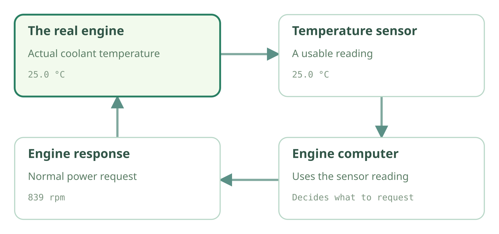
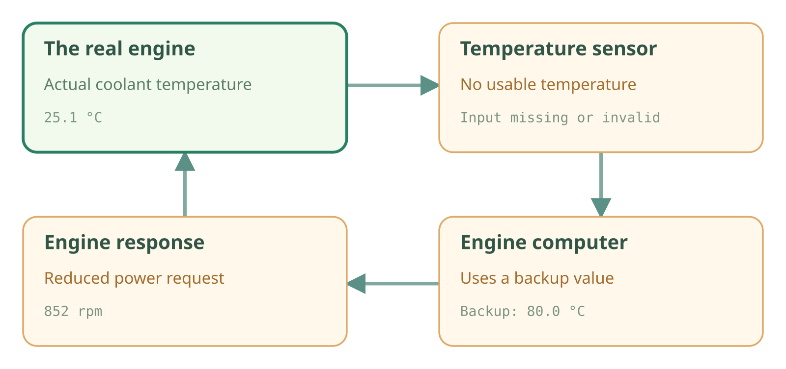
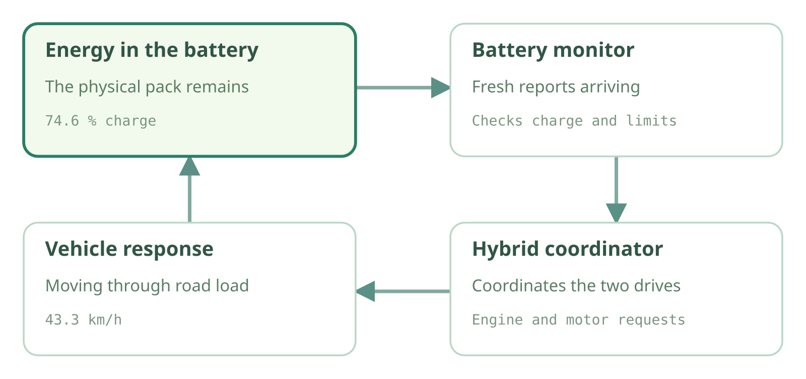
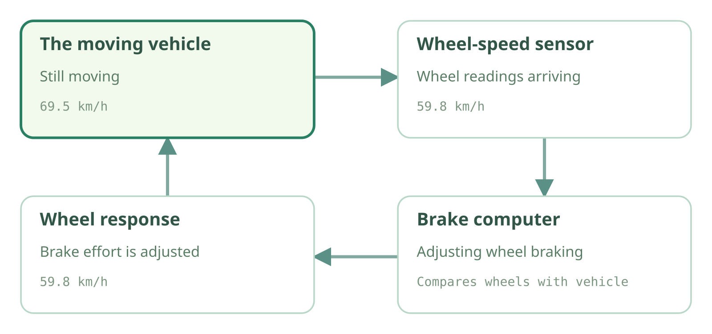

# A beginner’s book of vehicle signals

> **Recovered v0.4.0 scope.** The original teaching text and numerical examples are retained below. The two PDF books remain v0.3 reading copies; use [Visual Workbench](VISUAL_WORKBENCH.md) and its new PDF as the v0.4 addendum for vehicle, connection and protocol features. The app now opens the visual Workbench; Learning book and Instruments remain available.

OBD II Lab · Version 0.3.0 · 9 November 2026

## How to use this book

The interactive browser workbench combines a chapter tree, plain-language explanation, a diagram and a small experiment. Choose a chapter on the left, start its lesson, change one input and read what happened. Detailed electrical values and message bytes are optional deeper references. You can learn the main cause-and-effect ideas without typing them.

This PDF or printed copy contains the explanations and exercises. Its pictures and text are a reading reference. To move controls, disconnect a virtual sensor, advance time or collect a live trace, open the supplied browser workbench. A PDF viewer does not run the Python simulation.

### The four questions to ask

1. What did I change?
2. What does the physical part actually do?
3. What information reaches the computer?
4. What does the computer decide, and why?

### Controls in ordinary words

| Control or display | Meaning |
|---|---|
| Start this experiment | Begin a fresh experiment with its defined starting conditions. |
| Watch it run / Pause and inspect | Let simulated time advance, or stop it so you can inspect the current state. |
| One small step / Run five seconds | Advance 0.1 seconds or five seconds of simulated time, then inspect the result. |
| Accelerator / Brake | Change the driver request in an experiment that permits manual inputs. |
| Disconnect the temperature sensor / Disconnect the front-left wheel sensor | Break the named virtual measurement path. The physical part remains in the model. |
| Reconnect / restore the input | Restore the currently injected measurement or communication fault. |
| Restart after repair | Restart the teaching controller after restoring its input; useful for the latched battery-message shutdown. |
| Stop the battery monitor reports | Remove or restore the repeated information from the battery computer. This is a communication failure, not a removed battery. |
| Read remembered engine warnings | Ask for the condition remembered by the engine computer and read its meaning. |
| Clear remembered engine warnings | Remove stored engine diagnostic history; it does not repair an active failure. |
| Advanced detail | Open the electrical values, signal identifiers, equations or protocol bytes when useful. |

Use the currently available controls in the chosen lesson. A scripted lesson supplies some driver actions itself. Open Choose the starting conditions to change a starting temperature or charge level, then choose Start this experiment to apply those settings as a new comparison. The current fault model selects one injected fault at a time.

### What is simulated?

The engine, battery, hybrid coordination, four longitudinal wheels and simplified brake controllers are working teaching models. Their values and thresholds are chosen for learning. The models have not been calibrated against a specific vehicle. The Toyota reference documents describe real historical architectures separately. Original firmware, a detailed charger, the full vehicle network and production stability-control behavior remain later stages.

## 1. Start here: change one thing

**Aim:** Follow a change from the driver or a sensor to the computer and then to the vehicle.

Think of this book as a workbench beside an explanation. The chapter tree stays on the left. On the right you can read, inspect a diagram, change one control and watch the result. You do not need to type computer commands or understand message codes to complete the lessons.

A sensor measures something. A vehicle computer checks the measurement and makes a decision. An actuator carries out a request, for example by changing engine effort or brake force. The engine, battery or wheels then respond. That response is measured again, so the loop repeats.

The drawing and the instruments describe the same running experiment. Start with the words: what changed, what the sensor reports, what the computer decided, and why. Ordinary measurements such as temperature and speed help you compare before and after. Detailed electrical values and message bytes are available when you want to look deeper.

This is a teaching vehicle. Its engine, battery and braking models are deliberately small enough to understand. Toyota documents provide separate examples of real vehicle architecture; the lab is not Toyota production software. The PDF is the reading and printing copy. Run the browser workbench to operate the controls.

### Try it

1. Choose Start this experiment and leave the controls unchanged for a moment.
2. Choose Watch it run, then Pause and inspect. Notice that simulation time stops when paused.
3. Change one control, choose One small step and read the explanation of the result.
4. Choose Start this experiment again before comparing another change, so both experiments start from the same conditions.

### What to notice

- A command is a request, not an instant physical result.
- A measured value can be missing or wrong even when the physical part still exists.
- Faster playback advances simulated time faster on your screen; it does not change the model equations.

**Explain it in your own words:** When you change the pedal, what changes first and what takes longer?

## 2. An engine responds gradually

**Aim:** See why engine speed and temperature respond on different timescales.

The request, computer decision, physical engine and returning measurement form a repeated loop. This picture is a reference snapshot; the browser controls run the model.

The accelerator asks for more engine effort. The engine computer turns that request into a bounded command. The rotating parts have inertia: they resist a sudden change of speed. Engine speed therefore moves toward a new condition rather than jumping instantly.

The engine also produces heat. Coolant and metal store some of that heat, while cooling removes some. Temperature rises when heating is greater than cooling. It falls when cooling is greater. This is why a brief pedal change does not instantly heat or cool the engine.

This first experiment is an engine on a virtual test stand. There is no moving car attached to it. Engine speed can rise while vehicle speed stays at zero, and battery or wheel instruments are marked unavailable. That is an intentional smaller starting model.

Engine speed means how many turns the crankshaft makes in one minute. Temperature tells us how warm the coolant is. Fuel flow tells us how quickly fuel is being used. Read the explanation beside a measurement before interpreting a larger number as better or worse.

### Try it

1. Choose Start this experiment for a fresh engine lesson.
2. Choose Watch it run with a modest accelerator setting and watch engine speed settle.
3. Increase the accelerator, then compare the immediate speed change with the slower temperature change.
4. Pause and inspect the engine loop: request, computer decision, physical response and measurement.

### What to notice

- A turning engine has stored motion; it does not stop or accelerate without a physical cause.
- Coolant warms gradually because the model includes heat storage.
- The engine stand intentionally has no installed battery controller or wheel controller.

**Explain it in your own words:** Why can engine speed change quickly while the coolant temperature changes slowly?

## 3. How the computer knows the temperature

**Aim:** Separate the real temperature, the measurement and the value used for control.

The computer cannot feel the coolant directly. A temperature-sensitive component changes its electrical resistance as it warms. In this circuit, warming reduces resistance. Together with a fixed resistor inside the computer, it makes a voltage that the computer can measure.

The computer turns the measured voltage into a temperature estimate. In normal operation that estimate stays close to the actual coolant temperature. Small differences are expected because this model rounds an electrical measurement to a finite set of digital steps.

Keep three ideas separate. Actual temperature is what the physical model says the coolant is doing. Reported temperature is what the sensor path lets the computer estimate. Control temperature is the value the computer chooses to use. They agree closely when healthy but can differ after a fault.

The connector drawing shows a signal path and a return path. Opening the signal path breaks the measurement circuit; it does not remove heat from the coolant. The labels X1 and J-ECT are names chosen for this teaching harness, not the connector numbers of a particular Toyota.

### Try it

1. Start with the sensor connected.
2. Change the starting temperature when the lesson offers that setting, then reset or apply the new starting condition.
3. Compare the actual temperature with the reported temperature and the temperature used by control.
4. Select the wire or sensor in the drawing and read its explanation before opening the advanced electrical details.

### What to notice

- A healthy sensor report should follow the physical temperature.
- For this particular temperature-sensor circuit, warmer coolant produces a lower signal voltage.
- The actual wire voltage and the rounded computer representation are separate observations of the same circuit.

**Explain it in your own words:** If a sensor reading changes, must the real temperature have changed?

## 4. What happens when a sensor is disconnected?

**Aim:** Explain a sensor fault without mistaking it for a sudden physical temperature change.

A broken measurement path changes what the computer knows, while the physical coolant remains in the model. This is a reference snapshot; disconnect the sensor in the browser to observe the timed response.

Begin with a healthy engine, then disconnect the coolant sensor using the lesson fault control. The sensor branch no longer carries current. The computer input is pulled high by its internal resistor. That high input cannot be treated as a believable temperature measurement.

The real coolant remains warm. The model shows an invalid cold reading in the sensor report, but its plain-language note explains that this is a failed measurement. A value marked invalid is not evidence that the physical engine reached that temperature.

The engine computer waits briefly to see whether the bad input persists. In this lesson, after one fifth of a second it uses a substitute temperature and reduces its requested engine effort. After half a second it stores a confirmed warning and turns on the engine warning lamp. These short waiting times are teaching choices, not a manufacturer calibration.

Reconnecting the sensor repairs the signal path. The current measurement can recover while the stored warning remains as a record of what happened. Clearing warning memory removes that record. Clearing memory while the sensor is still disconnected leaves the cause in place, so the warning can return.

### Try it

1. Choose Start this experiment, then Watch it run until you see a normal measurement.
2. Choose Disconnect the temperature sensor, then One small step.
3. Compare actual temperature, invalid sensor report and substitute control value as time advances.
4. Read the stored warning in words. Repair the sensor connection, then clear the engine warning memory.
5. For a second experiment, clear the warning while still disconnected and observe why it returns.

### What to notice

- The failure begins in the measurement path, not in the physical coolant.
- The substitute is a chosen control value; it is not a new measurement.
- Repairing a cause and clearing its history are separate actions.

**Explain it in your own words:** Why should clearing a warning fail to repair a disconnected wire?

## 5. The battery computer sets limits

**Aim:** Understand why the vehicle may refuse a request even when the driver keeps pressing the pedal.

The battery stores energy, but it cannot provide or accept unlimited power. Its controller watches charge level, temperature and voltage-related inputs. It tells the rest of the vehicle how much battery power may be used for driving and how much may be returned during braking.

Charge level is an estimate of how full the battery is. Low charge can make the hybrid controller request more engine use. A nearly full battery may have little room to accept recovered braking energy, so the friction brakes must do more of the stopping work.

The battery computer sends repeated status reports to the hybrid controller. A report needs to be both believable and recent. If updates stop, the last received numbers may still look reasonable. The workbench marks them as old while the actual battery model can continue changing.

Try stopping the battery status messages. In this model, a report older than roughly three tenths of a second causes the hybrid controller to inhibit driving effort and request disconnection of the high-voltage path. That stop is latched: restoring messages alone does not remove it. Restore the messages, then choose Restart after repair or start a fresh experiment. This is the selected teaching policy, not a promise about every real vehicle.

### Try it

1. Choose Start this experiment, then Watch it run, and observe when the engine is requested in this low-charge lesson.
2. Compare the current physical battery state with the latest report received by the hybrid controller.
3. Use the fault control to stop battery status updates, then advance the simulation.
4. Watch the report become old and read why the controller stops allowing driving effort.
5. Choose Reconnect / restore the input, then Restart after repair to clear the teaching shutdown latch.

### What to notice

- A battery limit is permission, not a demand to use that much power.
- A held old value is different from a live measurement and different from zero.
- A stored shutdown condition can remain after the immediate communication problem is repaired.

**Explain it in your own words:** Can an old, believable battery report be trusted as a current report?

## 6. The engine and motor work together

**Aim:** Explain how driver demand and battery limits change the use of engine, motor and brakes.

The hybrid coordinator shares a driver request between the engine and motor within battery limits. This is a reference snapshot; the browser experiment changes the values as it runs.

The hybrid supervisor coordinates the engine, electric motor and battery. It receives the driver request and checks what the other components can provide. It can request electric driving, engine assistance, or a mode that tries to preserve the battery charge.

During acceleration, stored battery energy and fuel energy can become motion. During braking, the motor can act as a generator and return some motion energy to the battery. This is regenerative braking. Some energy is still lost, and the battery has limits on how much power it can accept.

Friction brakes turn motion energy mainly into heat. They provide the part of the requested braking that regeneration cannot supply. A fuller battery can therefore mean less recovered energy and more friction-brake work during the same braking request.

The diagram separates requests, information and energy flow. A line carrying a power value does not necessarily represent a physical harness wire. This lab uses a generic parallel-hybrid arrangement. A Toyota Prius power-split arrangement is explained separately in the reference material.

### Try it

1. Choose Start this experiment, then Watch it run, and read the plain-language hybrid operating mode.
2. Choose Pause and inspect during acceleration and identify the engine and motor contributions.
3. Continue into braking and observe whether the battery is supplying energy or receiving it.
4. Compare with the nearly-full-battery braking lesson in the experiment list.

### What to notice

- The same pedal request can lead to a different decision when battery permission changes.
- Returned battery energy is smaller than the mechanical energy recovered because the model includes conversion losses.
- The motor and friction brakes must share a physically meaningful braking task.

**Explain it in your own words:** When the battery cannot accept more charging, where must the braking energy go?

## 7. Why ABS watches the wheels

**Aim:** Compare vehicle motion with wheel motion and see the brake controller adjust its request.

The brake controller compares wheel measurements with the vehicle motion and adjusts brake effort. This is a reference snapshot; use the browser for the moving wheel and braking experiment.

A moving vehicle and a rotating wheel are related, but they are not the same thing. During hard braking a wheel can slow too much compared with the vehicle. It may slide across the road instead of rolling normally. The workbench calls this difference braking slip.

The anti-lock brake controller watches the wheel-speed inputs and adjusts a brake multiplier. In this model it reduces braking on a wheel when slip becomes too large, then allows braking to build again. The multiplier is a relative command, not measured hydraulic pressure.

The lesson begins with less grip on one side of the road than the other. The wheels therefore do not all respond alike. Compare each wheel with the vehicle body speed and watch which brake commands change.

The lab also has a simplified yaw-assistance model. Yaw means the vehicle turning left or right around a vertical axis. The model demonstrates a feedback idea, but it does not reproduce a full vehicle stability-control system or all road conditions. Compare the supplied case carefully; it does not prove that ABS always makes every stopping distance shorter.

### Try it

1. Choose Start this experiment, then Watch it run, for the unequal-grip braking lesson.
2. Choose Pause and inspect after braking begins and compare vehicle speed with each wheel speed.
3. Inspect a wheel-speed signal and the corresponding brake multiplier.
4. Choose Start this experiment for a fresh comparison, then use the next chapter to see what changes when a wheel signal is missing.

### What to notice

- A wheel turning much too slowly can be sliding while the vehicle is still moving.
- The controller changes individual brake commands because the wheels can have different grip.
- A comparison is meaningful only when starting speed, road conditions and driver request are held consistent.

**Explain it in your own words:** Why does the controller need wheel speed as well as the driver brake request?

## 8. Turn off one wheel-speed signal

**Aim:** Distinguish a sensor failure from a physical wheel locking.

Disconnect the front-left wheel-speed signal in the virtual lesson. The physical wheel remains in the vehicle model and may still be rotating. Its measured input becomes unavailable. The diagram and notes keep those two facts separate.

The selected teaching policy disables both anti-lock modulation and the simplified yaw-brake assistance when that wheel input is missing. The driver brake request still produces friction braking. Losing assistance does not mean the model has removed every brake.

A blank or missing sensor value must not be interpreted as a measured zero. Zero would mean the sensor successfully reported a stopped wheel. Missing means the controller does not have a usable report from that input.

Reconnect the sensor and observe the measurement return. Assistance can resume when its speed and control conditions are met, while the module fault record remains part of the experiment history. Choose Start this experiment when you want to begin a new clean comparison.

### Try it

1. Start the wheel-sensor lesson with the vehicle already moving.
2. Apply or keep a brake request and observe the healthy signals first.
3. Choose Disconnect the front-left wheel sensor, then One small step.
4. Compare the physical wheel speed, missing sensor report and changed brake-controller status.
5. Choose Reconnect / restore the input, then Start this experiment before measuring a fresh before-and-after comparison.

### What to notice

- The wheel can keep rotating after its sensor signal disappears.
- The missing input is shown as unavailable, not as a fabricated zero.
- In this model friction braking continues while the selected electronic assistance is disabled.

**Explain it in your own words:** What would go wrong if a missing sensor were silently displayed as a zero-speed wheel?

## 9. Ask the computer what happened

**Aim:** Read current measurements and stored warnings in ordinary words.

A diagnostic tool asks a vehicle computer questions. Useful beginner questions are: What temperature do you currently report? Are you using a substitute value? Have you stored a warning? The workbench explains the answer before showing the underlying message representation.

A stored trouble code names a condition the computer detected. It is evidence to investigate, not proof that one particular physical part must be replaced. A disconnected sensor, a broken wire or another input-circuit problem can be related to the same kind of detected condition.

Current measurement, active failure and stored history are different. A repaired signal can give a normal reading while the computer still remembers the earlier fault. Clearing engine warning memory removes that record; it does not repair a connection or guarantee that every monitor has completed.

Generic OBD-II mainly concerns emissions-related reporting. In this lab the engine scan questions do not automatically reveal every battery or brake-controller fault. Read those module explanations in their own lessons. The optional advanced view shows message bytes for people who want to learn the protocol later.

### Try it

1. Choose Start this experiment, then Watch it run, and read the explanation as the coolant-sensor fault develops.
2. Ask for the current coolant reading and compare it with the physical temperature.
3. Choose Read remembered engine warnings and compare the pending and stored history.
4. Repair the sensor path, choose Clear remembered engine warnings, and check the current state again.

### What to notice

- An invalid reading needs its validity note, even if it is displayed as a number.
- Stored history can outlast the immediate fault.
- Engine emissions diagnostics and other vehicle-module reports have different scopes.

**Explain it in your own words:** Does a stored warning identify the exact damaged part, or the problem the computer detected?

## 10. From a small lesson to a virtual vehicle

**Aim:** See how the workbench can grow while keeping each change understandable.

A useful next step has one clear question. For example: Can a new battery model explain a measured current trace? Can a different engine controller react to the same temperature-sensor failure? Keep the surrounding experiment steady so the effect of the changed part is visible.

For each new subsystem, write down what it measures, what it controls, the units, how often it updates and what happens when information is missing. Add a clear diagram and one reproducible healthy case before adding several interacting faults.

The current workbench can exchange high-level driver and plant information through its supplied software interfaces. Original vehicle firmware is a later task. Such a program expects a particular processor, memory layout and hardware peripherals; a diagram or an arbitrary firmware file is not enough to run it correctly.

The full theory and reference chapters remain available in the document tree, including equations, diagnostic bytes, existing software bases, Toyota examples and the firmware roadmap. The supplied EngDoc format has now been inspected. The separate native coolant worksheet lets you change a temperature and disconnect its measurement path; docs/ENGDOC_INTEGRATION.md explains its scope. It calculates a static circuit and does not replace the timed browser model or run vehicle firmware.

### Try it

1. Choose one component and one question to investigate.
2. Record its inputs, outputs, units, update period and invalid-input behavior.
3. Run a healthy baseline, change one assumption and compare the same measurements.
4. Use the theory and reference chapters when you need the equations or implementation detail behind a result.

### What to notice

- A more detailed model should explain an additional behavior, not merely add more blocks.
- A claimed real-vehicle parameter needs a source and vehicle-version context.
- The PDF can explain a lesson; the browser workbench is where its interactive controls run.

**Explain it in your own words:** What measurements and timing would a new controller need before it could replace this teaching block?

## Three guided fault exercises

### Exercise A: disconnect the coolant sensor

**Prediction:** The real coolant should remain near its previous temperature, but the engine computer should lose a believable temperature measurement.

1. Start a healthy engine lesson and observe the three temperatures: physical, reported and used for control.
2. Choose Disconnect the temperature sensor. Advance time with One small step.
3. Read the invalid-measurement explanation. Continue until the substitute control value and stored warning appear.
4. Choose Reconnect / restore the input. Check that the current reading recovers even if a warning remains stored.
5. Clear engine warning memory. Repeat once without repairing the connection and explain why the warning returns.

**Expected result in this model:** An open sensor branch carries no current. Its input voltage reaches the reference level. The displayed sensor-temperature sentinel is invalid, while the physical coolant stays warm. The chosen fallback begins after 0.20 seconds of persistent high input; confirmation follows after 0.50 seconds. These timers and the substitute temperature are lesson settings. The detailed reference identifies the engine trouble code as P0118; learning the code is optional.

### Exercise B: turn off a wheel-speed input

**Prediction:** Losing the report should not physically remove or stop the wheel.

1. Start the moving-wheel lesson and observe the actual front-left wheel speed and its measured report.
2. Apply a brake request and disconnect the front-left sensor signal.
3. Compare the still-existing wheel state with the unavailable sensor input.
4. Read the brake-controller decision. Friction braking remains, but this teaching policy disables anti-lock modulation and its simplified yaw assistance.
5. Choose Reconnect / restore the input, then Start this experiment before measuring a new clean stopping comparison.

**Expected result in this model:** The missing measured speed is blank or unavailable, never a fabricated measured zero. Assistance can resume after reconnection when its normal speed/control conditions are met. The stored module record remains part of experiment history until reset.

### Exercise C: stop battery status reports

**Prediction:** The last reported value can look normal while it becomes too old to trust.

1. Start a hybrid lesson and allow the vehicle to become ready.
2. Compare the current physical battery value with the value received by the hybrid controller.
3. Stop battery reports. Watch report age grow while the last received values remain held.
4. Continue until the hybrid controller declares the reports too old and inhibits driving effort.
5. Choose Reconnect / restore the input, then Restart after repair to remove the selected latched shutdown.

**Expected result in this model:** Reports older than about 0.30 seconds trigger the chosen communication-failure policy at the next supervising update. Restored communication alone does not unlatch that shutdown. This exercise removes a stream of information; it does not disconnect a real high-voltage connector or simulate a physically absent battery.

## Read the results without being misled

| What you see | What it means |
|---|---|
| Current and usable | The model currently supplies a usable value for this signal. |
| Invalid measurement | A value may still be displayed to explain the fault, but it is not a trustworthy measurement of the physical quantity. |
| Substitute used | The computer is using a documented replacement value after a detected problem. |
| Old report | The last received value is held; no recent update has arrived. |
| Unavailable | There is no usable value, or the chosen lesson does not contain that subsystem. |
| Stored warning after repair | The current input may be healthy while diagnostic history still records the earlier fault. |

The signal scope records samples every tenth of a second. Some controller decisions happen between those saved samples. Read the event explanation and current state when checking exactly when a fault was noticed. Curves help compare changes; they are not a recording of every wire voltage transition.

## A small amount of mathematics, in words

**Engine motion:** More turning effort than resistance makes engine speed rise. Greater rotational inertia makes the same extra effort change speed more slowly.

**Temperature:** Heating adds stored thermal energy. Cooling removes it. The temperature changes according to the difference and the amount of heat the modeled engine/coolant can store.

**Battery charge:** Current flowing out reduces the stored charge; current flowing in increases it. The model also accounts for internal electrical loss. Charge percentage is not a complete battery-health assessment.

**Braking:** The brakes must remove motion energy. Regeneration can return part of it to the battery within permission and efficiency limits; friction brakes supply the remainder.

**Measurement:** A physical quantity becomes an electrical input, then a digital representation, then an interpreted value. A fault or a rounding step can affect one layer without changing the others.

The full [Learning Guide](LEARNING_GUIDE.md) gives equations, units and worked calculations for these relationships. The [Working Cases](WORKED_CASES.md) reports results generated by the supplied model.

## Glossary: ordinary words first

| Term | Plain meaning | More context |
|---|---|---|
| Sensor | A part that measures something. | Examples are coolant temperature and wheel speed. A sensor report may be valid, missing or unreliable; the physical part being measured can still exist. |
| Engine computer / ECU | The computer that checks inputs and requests engine actions. | ECU means electronic control unit. In this lab, the engine ECU is a simplified software controller with a temperature-fault monitor. |
| Actuator | A part that carries out a control request. | Examples include a brake mechanism or a motor. The requested action and the actual physical result can differ because of limits and delays. |
| Physical model / plant | The simulated engine, battery, wheels and their physical behavior. | The plant changes according to equations. It is distinct from the controller that makes decisions. |
| Signal | A value or state passed from one part of the model to another. | A signal can mean a measurement, a request, a permission or a status. A line on a logical diagram is not automatically a physical wire. |
| Feedback | Using the measured result to decide what to do next. | The controller requests an action, the physical model responds, and a sensor reports the response. The loop repeats. |
| Coolant | The fluid represented by the engine temperature model. | The lab uses one average temperature. It does not model each coolant passage, thermostat or local hot spot. |
| Thermistor / NTC | A resistor whose resistance changes with temperature. | For this NTC model, warming lowers resistance. The computer measures a voltage produced by that changing resistance. |
| Voltage | An electrical difference measured between two points. | The lesson sensor signal is measured relative to the sensor return. A high voltage can mean a broken sensor path in this particular circuit. |
| Resistance | How strongly a part opposes electrical current. | A connected thermistor has a finite resistance. An open branch is shown as missing or invalid rather than a made-up very large reading. |
| Current | The rate of electrical charge flow. | In the battery model, current flowing out supplies energy for the vehicle; current flowing in charges the battery. The display explains the direction. |
| ADC | The computer input that turns a measured voltage into digital steps. | ADC means analog-to-digital converter. Finite steps cause small rounding differences even in a healthy ideal measurement. |
| Valid / invalid | Whether a measurement is usable for its stated purpose. | Invalid does not mean the number must disappear. It means the learner and controller must not treat it as a reliable measurement. |
| Unavailable | No usable value is present for this signal here. | A module may not be installed in the chosen lesson, or a sensor report may be missing. Unavailable is different from a measured zero. |
| Fallback / substituted value | A value the controller chooses when the normal measurement cannot be used. | A substitute supports the selected failure response. It is not a fresh sensor measurement and does not change the actual physical temperature. |
| Stale / old report | Information that has not been updated recently enough. | A last received battery report can remain believable while it is too old to use for current power permission. |
| Warning / trouble code | A stored name for a condition the computer detected. | It helps identify a problem area. It does not by itself prove which physical part caused the condition. |
| Battery computer / BMU | The controller that reports battery condition and allowed power. | BMU means battery management unit. BMS is another common battery-management name. This lab uses a simplified pack model. |
| Charge level / SOC | How full the battery is estimated to be. | SOC means state of charge. It is commonly shown as a percentage; it is not the same as the battery voltage or total lifetime health. |
| Power | How quickly energy is being transferred. | A power limit is a permitted rate, not a request to use all of it. Battery power, mechanical motor power and recovered braking power can differ. |
| Contactor | A controlled switch in the high-voltage power path. | The lab represents its state and a simplified precharge sequence. It does not simulate relay arcs or provide physical wiring instructions. |
| Hybrid supervisor | The computer coordinating engine, motor, battery and braking requests. | Its decision depends on driver demand and component permissions. This lab demonstrates a generic strategy rather than Toyota software. |
| Regenerative braking | Slowing the vehicle while returning some motion energy to the battery. | The motor acts as a generator. Battery acceptance and conversion losses limit how much energy is recovered. |
| Friction braking | Slowing the vehicle by turning motion energy mainly into heat at the brakes. | It supplies braking that regeneration cannot provide. In the missing wheel-sensor lesson it remains present when electronic assistance is disabled. |
| ABS | Anti-lock braking assistance. | ABS compares wheel behavior with vehicle motion and changes individual brake commands to reduce excessive braking slip in the teaching model. |
| Slip | The difference between wheel rolling speed and vehicle speed during braking. | A wheel turning too slowly for the vehicle speed may be sliding. The model uses a regularized ratio to express that difference. |
| Yaw / ESC / ESP | Vehicle turning motion and the assistance intended to influence it. | Yaw is rotation left or right around a vertical axis. ESC and ESP are stability-control names; this lab includes only a simplified yaw-assistance demonstration. |
| OBD-II | A standard way to inspect emissions-related vehicle information. | The lab includes current engine readings and engine warning memory. Other module information may require separate manufacturer-specific diagnostics in a real vehicle. |
| CAN | A communication method used by vehicle computers. | The lab can display diagnostic frames and exchange them in a virtual-bus example. Physical voltage waveforms, wire faults and real bus arbitration are not modeled. |
| Firmware | The program intended to run inside a particular electronic controller. | It depends on its processor and hardware environment. Running original firmware is a future integration task, not a current feature of this workbench. |

## References and evidence boundaries

The executable code and tests describe what this release actually does. The sources below support general principles and terminology; they do not validate the lab’s synthetic parameters or chosen failure policies. The complete source and Toyota-document inventory remains in [Sources](SOURCES.md).

- California Air Resources Board: [On-Board Diagnostic II Systems Fact Sheet](https://ww2.arb.ca.gov/resources/fact-sheets/board-diagnostic-ii-obd-ii-systems-fact-sheet). Supports the emissions-related scope of OBD-II.
- Texas Instruments: [Monitoring NTC Thermistor Circuit With Single-Ended ADC, SBAA338A](https://www.ti.com/lit/an/sbaa338a/sbaa338a.pdf). Supports the temperature-resistance-divider and ADC principles. The lesson values are selected separately.
- Toyota Motor Corporation: [Toyota Develops New Hybrid System](https://global.toyota/en/detail/220017), 17 April 2003. A historical manufacturer example of hybrid operation and power splitting, separate from this generic plant.
- Bosch Mobility: [Electronic stability program](https://www.bosch-mobility.com/en/solutions/braking-systems/electronic-stability-program/). Supports the role of wheel-speed, steering and yaw information in stability assistance. The lab’s reduced model is not Bosch software.
- QEMU: [Arm System emulator](https://www.qemu.org/docs/master/system/target-arm.html), and Renode: [Peripheral modeling guide](https://renode.readthedocs.io/en/latest/advanced/writing-peripherals.html). Explain why firmware needs a suitable processor and peripheral environment.

Continue with [Schematic Workspace](SCHEMATIC_WORKSPACE.md), [Connector Reference](CONNECTOR_REFERENCE.md), [Protocol](PROTOCOL.md), [Existing Bases](EXISTING_BASES.md), and [Firmware Roadmap](FIRMWARE_ROADMAP.md) when you are ready for more detail.
