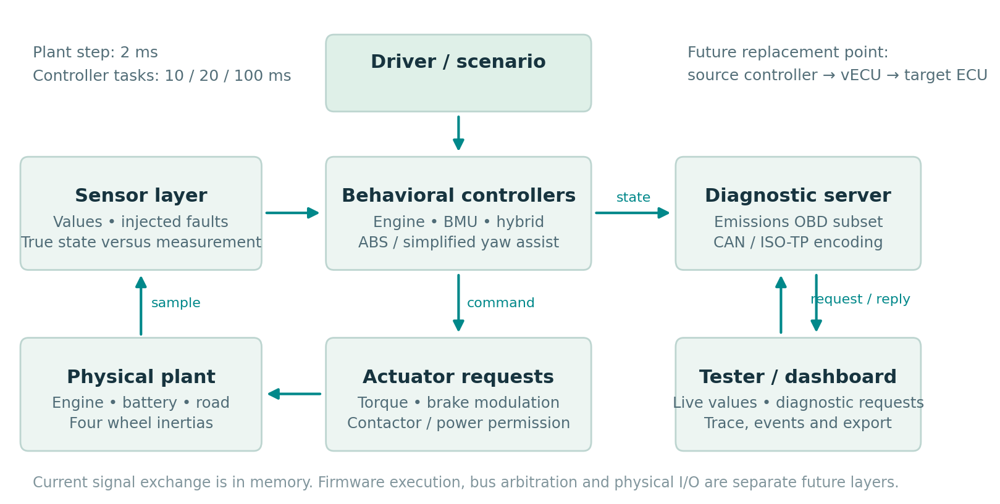

# OBD-II and virtual vehicle learning lab

> **Recovered v0.4.0 scope.** The original teaching text and numerical examples are retained below. The two PDF books remain v0.3 reading copies; use [Visual Workbench](VISUAL_WORKBENCH.md) and its new PDF as the v0.4 addendum for vehicle, connection and protocol features. The app now opens the visual Workbench; Learning book and Instruments remain available.

Version 0.3.0 • 9 November 2026

## 1. What you are learning

This lab connects three ideas that are easy to confuse: a physical vehicle, the controllers that operate it, and the diagnostic interface used to inspect it. Start with one engine controller, then introduce a battery controller, a hybrid supervisor and brake controllers. The same plant and diagnostic boundaries can later host more detailed models or an external controller.

**OBD-II is an onboard diagnostic framework concerned principally with emissions-related monitoring and reporting.** An engine controller can report speed, temperature and faults through it. A vehicle contains many other controllers, and their manufacturer-specific data is not automatically available through the generic OBD-II PID set. A connector can carry both kinds of communication. The California Air Resources Board explains OBD-II's emissions-monitoring purpose; Toyota's training material separately identifies the engine, hybrid, battery and skid-control computers. [S1, T1]

In this package, the plant and controllers are executable teaching models. Diagnostic values come from the current simulation state rather than a fixed list of canned replies. That makes it possible to change the throttle, inject a sensor fault, observe a controller response and then read the resulting diagnostic data.

### The boundary of this version

The engine stand is a mean-value model: it calculates average torque, speed, fuel use and temperature. It does not simulate individual combustion events. The hybrid is a **generic parallel hybrid teaching architecture**, with a lumped battery, an idealized variable-ratio engine path and simplified engine/motor power allocation. Its PHEV label describes the intended vehicle class; grid charging and charger communication are future modules. It is not a calibrated Toyota Prius, Prius Plug-in or Prius Prime simulation. ABS uses individual wheel dynamics; the yaw/ESP demonstration remains an approximation rather than a full lateral tire and suspension model.

The package does not run Toyota firmware. It does not connect to a vehicle, program an ECU, or reproduce a proprietary Toyota CAN database. The supplied examples are useful for learning, debugging interfaces and forming requirements; matching a particular vehicle requires measurements and model identification.

## 2. Your first learning session

Unzip the package, open a terminal in its top-level directory, and start the dashboard:

```bash
python3 run.py --serve
```

Use the local address printed by the program. On Windows, `python` may be the installed interpreter command instead of `python3`. The lab uses the Python standard library; it does not require a paid modeling tool.

### Start with the learning book

The browser opens the visual Workbench. Choose **Learning book** to use the original guided lessons. Choose a beginner chapter on the left, read the explanation and select **Start this experiment**. Use **Watch it run**, **Pause and inspect** and **One small step** to follow the result. The fault buttons disconnect a named input; the live notes explain what changes and why. Reading another chapter keeps the current experiment. The [beginner handbook](BEGINNER_HANDBOOK.md) contains the same learning sequence and a glossary.

### Open the schematic instruments when ready

Choose **Instruments** or **Open detailed instruments** to enter the focused diagnosis workspace. Its fixed block and circuit diagrams use the running model state; clicking a signal or lesson pin lets you inspect it and add a scope channel. This release does not implement free-form block editing, arbitrary rewiring, a SPICE solver or firmware execution.

| Screen | Learning purpose |
|---|---|
| **Task workspace** | Follow the ECT fault task with a schematic, inspector, six-channel scope, diagnostic reply and controller timeline |
| **Connectors** | Inspect the J1962 vehicle-socket reference and the explicitly illustrative J-ECT/X1 lesson assignments |
| **Signal list** | Search 69 cataloged signals; inspect value, unit, source, validity and nominal update period; probe 67 numerical/digital channels |
| **Scan tool** | Send an application request and inspect its generated CAN/ISO-TP frames |
| **Dashboard** | Compare engine, battery, vehicle and braking responses in the other lessons |

Start **Healthy baseline**, which runs the engine stand for 1 s from a selected 25°C initial coolant state. Choose **ECT electrical circuit**, then **Open circuit**, **+0.20 s**, **+0.30 s**, **Read DTC**, and **Repair & clear**. Compare physical temperature, sensed temperature and the ECU fallback. The [workspace guide](SCHEMATIC_WORKSPACE.md) explains each observation; the [connector reference](CONNECTOR_REFERENCE.md) gives orientation, provenance and pin assignments. J-ECT and X1 are invented teaching labels, not a Toyota wiring diagram.

Scope recordings are 100 ms apart. Invalid, substituted and stale finite values use dashed segments; missing or null values leave a gap. An open thermistor branch has a `null` resistance marked **invalid**, not a very large invented finite measurement. Use validity and the event timeline alongside the plotted numbers.

### Continue through the vehicle lessons

Work through these repeatable scenarios in order:

1. Run **engine_warmup**. Watch engine speed, coolant temperature and fuel flow. Ask for `01 0C` and `01 05` in the diagnostic panel. Connect the physical value, encoded bytes and decoded result.
2. Run **ect_open**. Compare the true coolant temperature with the faulty sensor signal. Notice that a diagnostic report describes a detected electrical fault, not necessarily an overheated engine.
3. Run **phev_city**. Follow the path from driver request to engine/motor contribution, battery current and vehicle acceleration.
4. Run **regen_limit**. Observe the brake demand that the battery can accept and the demand that friction brakes must supply.
5. Run **abs_split_mu**. Compare four wheel speeds and slip values when left and right road friction differ.
6. Run **bmu_timeout** and **cell_low**. Examine why a controller can deny a request even when the driver continues pressing the accelerator.

The command line can reproduce a scenario and save data for inspection:

```bash
python3 run.py --scenario engine_warmup --duration 120 --output examples/my_warmup
python3 run.py --scenario phev_city --duration 60 --output examples/my_city
python3 -m unittest discover -s tests -v
```

Use the shipped example results as a starting point. Re-run after changing a parameter and compare the same quantities over the same time interval. A successful test checks the specified implementation behavior; it does not establish agreement with a real vehicle.

## 3. A controller does not create the physical result directly



Consider a temperature reading. The engine has a physical temperature. A sensor and its electrical interface transform that temperature into a measurement. Software checks plausibility, filters or substitutes the reading, and makes a decision. The OBD server encodes a reported value. These are four separate quantities, even when they happen to agree.

| Layer | Example | Question to ask |
|---|---|---|
| Plant | Crankshaft inertia, coolant heat capacity, tire forces | What changes according to physics? |
| Sensors | RPM estimate, coolant signal, pack current | What can the controller actually observe? |
| Controller | Idle control, battery power limit, brake-pressure request | What decision is made from those observations? |
| Actuators | Engine torque, inverter torque, contactor, brake torque | How does the decision affect the plant? |
| Network and diagnostics | Periodic signals, request/response, DTCs | What is transmitted, at which time, and in which units? |

The feedback loop repeats. A controller issues a bounded request; the plant responds; sensors sample that response; the next controller execution uses the new measurements. Holding one layer constant while changing another is a powerful experiment. For example, inject a coolant sensor fault while keeping actual coolant temperature unchanged.

### A vocabulary for the virtual vehicle

| Name | Role | Status in this lab |
|---|---|---|
| ECU | General term for an electronic control unit | Multiple conceptual controllers within one process |
| ECM / engine ECU | Engine torque, speed and thermal behavior; engine diagnostics | Simplified working controller and plant |
| BMU / BMS / battery ECU | Estimate battery state; calculate charge/discharge permissions | Working lumped-pack model and supervisory limits |
| PHEV-ECU / VCU / hybrid supervisor | Select propulsion mode; coordinate engine, motor and battery | Working generic supervisory model |
| Inverter and motor controller | Convert electrical power to torque and vice versa | Average power/torque model; electrical switching and current loops absent |
| ABS | Modulate braking when wheels approach lock | Working four-wheel longitudinal demonstration |
| ESP / ESC | Compare intended and actual vehicle rotation; influence torque and wheel braking | Approximate yaw-assist demonstration |
| OBC | Onboard charger for grid-to-battery energy transfer | Planned; no AC charge-port model in this release |
| DC/DC and 12 V supply | Power low-voltage loads and control electronics | Auxiliary power allowance; detailed low-voltage network planned |
| TCU / transmission controller | Gear, clutch or transmission coordination | Transmission represented by simplified ratios; no separate TCU |
| Gateway | Route messages between networks; control diagnostic access | Planned; current signal exchange is in process |
| BCM / body controller | Lighting, doors, wake/sleep and cabin functions | Planned |
| EPS | Electric power steering and steering assistance | Steering is an input; EPS motor and rack dynamics planned |
| SRS / restraint controller | Crash sensing and occupant restraint decisions | Outside this release; needs a separate specialized model |
| HVAC / thermal manager | Cabin, battery, engine and power-electronics heat management | Lumped engine/battery cooling only |
| Cluster / telematics / ADAS | Displays, external communication, driver assistance | Dashboard is a learning display; production functions planned |

Real manufacturers distribute these functions differently. Several functions may share a computer; one function can also span multiple computers. The module names are architectural teaching boundaries, not a claim about the exact ECU inventory of a particular car.

## 4. What sensors and signals does each module need?

The following is a design checklist for extending the lab. Rates are **suggested educational starting points**, not OEM specifications. This release uses slower supervisory abstractions where electrical details are unnecessary. Its signal catalog carries a value, unit, snapshot timestamp, validity status, source and nominal update period for each registered signal. A snapshot timestamp is not a separately modeled sensor-acquisition or network-arrival timestamp; the BMU freshness model exposes its own message age.

| Controller | Essential inputs | Outputs | Starting timing and failure behavior |
|---|---|---|---|
| Engine ECU | Crank/cam position, pedal and throttle position, coolant and intake temperature, MAF or MAP; later lambda, knock and fuel pressure | Torque/throttle request; later injection and ignition timing, fan and pump | Implemented average controller: 10 ms. Real crank events need angle/event scheduling. Reject implausible temperature; use a documented fallback and diagnostic. |
| BMU | Pack current A, pack voltage V, cell/block voltages V, temperatures °C; later isolation and contactor feedback | SOC %, available charge/discharge power, cooling demand, HV permission | Implemented supervisor: 100 ms. Fast hardware protection is a different layer. Stale or invalid limiting data must not grant unlimited power. |
| Hybrid supervisor | Driver request, vehicle speed, engine availability, BMU limits, gear/ready state, brake demand | Engine and motor requests, mode, start/stop coordination | Implemented supervisor: 20 ms. Hysteresis reduces rapid mode switching. Communication loss inhibits propulsion in the teaching policy. |
| Motor/inverter | Torque request, DC voltage/current, speed; later resolver angle, phase currents and device temperatures | Actual torque, power and limit flags; later PWM | Implemented average model follows plant steps. A future electrical model may need microsecond-scale integration and current-control scheduling. |
| ABS/ESC | Four wheel speeds, brake demand/pressure, steering angle, yaw rate; later lateral/longitudinal acceleration | Per-wheel brake modulation and requested torque reduction | Implemented brake control: 10 ms. A wheel-sensor failure must be represented explicitly, not silently replaced by a perfect reading. |
| Charger / DC/DC | Plug state, available AC power, HV and LV voltage/current, thermal state | Charging current, contactor requests, low-voltage regulation | Planned: choose supervisory and converter times separately. Inhibit traction during an accepted charging connection. |
| Gateway / body | Heartbeats, ignition/wake requests, network state, diagnostic sessions | Routed frames, wake/sleep and access state | Planned: model freshness deadlines and routing; message arrival is not proof of signal validity. |

### Choose signal units before choosing a bus

Use SI units inside a plant wherever practical: m/s, rad/s, N, N·m, A, V, W and seconds. Display conversions may use km/h, RPM, °C and kW. SOC is a fraction in equations and a percentage on the display. State which representation an interface uses.

For each future CAN signal, record identifier, direction, payload length, bit position, endianness, signedness, scale, offset, range, invalid code, period, timeout and any counter/checksum. A plausible CAN identifier is not a verified Toyota identifier. Keep synthetic teaching messages in a clearly named database; introduce real messages only with source evidence and versioned vehicle applicability.

## 5. The mathematics, one component at a time

These equations explain the model boundaries and provide hand-checkable exercises. Numeric values below are deliberately chosen examples. They are not measurements or calibration values from the supplied Toyota documents.

### Implemented starting values

The hand exercises use round numbers so they can be checked independently. The executable plant starts from the following separate teaching assumptions, available in `obdii_lab/core.py`. Scenario-specific initial conditions can override the defaults.

| Quantity | Implemented assumption | Interpretation |
|---|---|---|
| Vehicle mass; wheel radius | 1,600 kg; 0.31 m | Generic vehicle, no Toyota fit |
| Wheel inertia; wheelbase | 1.5 kg·m² per wheel; 2.70 m | Four longitudinal wheel states; simplified yaw reference |
| Battery capacity; internal resistance | 50 Ah; 0.12 Ω | One lumped equivalent circuit |
| Open-circuit voltage | `300 + 100 × SOC` V | SOC is a 0–1 fraction; synthetic linear curve |
| Reported cell extrema | Aggregate pack voltage divided by 96, with a small spread | Illustrative signals, not 96 independent cell models |
| Nominal power ceilings | 80 kW discharge; 40 kW charge | Further reduced by current, SOC, temperature and contactor state |
| Charge taper | 90–98% SOC | Teaching thresholds, not a battery manufacturer's limits |
| Motor/inverter efficiency | 0.90 motoring; 0.88 regeneration | Constant averages, not measured efficiency maps |
| Precharge | First-order time constant 0.12 s; minimum 0.4 s and 95% of open-circuit voltage before closure | Behavioral sequence without switching arcs or a physical relay model |
| Engine stand inertia | 0.28 kg·m² | Mean torque and virtual dynamometer load |
| Coolant thermal capacity | 35,000 J/K | One heat-storage state with simplified cooling |
| ECT reference; pull-up | 5.0 V; 2,200 Ω | Ideal reference shared with ADC; no wiring resistance or settling model |
| ECT thermistor | 2,500 Ω at 25°C; beta 3,500 K | Selected NTC curve, not a Toyota sensor calibration |
| ECT ADC | 12 bits, counts 0–4095 | Ideal rounding and reconstruction, without conversion noise |

Read each configurable value's unit before changing it. Some controller constants remain in source; they are not all dashboard controls. Increasing the UI playback speed advances more simulated time and does not change these physical parameters.

Precharge voltage is a behavioral timing state: capacitor/resistor energy and low-voltage starter energy are not included in the battery ledger. The energy counters support component-level checks, including battery chemical power = terminal power + internal resistive loss. They do not establish complete vehicle energy closure.

### 5.1 Engine speed and mean torque

Rotational dynamics follow:

\[
J\frac{d\omega}{dt}=T_{engine}-T_{load}-T_{friction},
\qquad RPM=\omega\frac{60}{2\pi}.
\]

`J` is rotational inertia in kg·m². A controller cannot change engine speed instantly when inertia is represented. Suppose `J = 0.20`, engine torque is `30 N·m`, and load plus friction is `10 N·m`. Acceleration is `100 rad/s²`. During `0.01 s`, speed increases by `1 rad/s`, or about `9.55 RPM`.

Mechanical power is `P = Tω`. At `100 N·m` and `2,000 RPM`, shaft power is `20.94 kW`. Fuel power must exceed useful shaft power. If an illustrative efficiency is `0.30`, fuel chemical power would be `69.81 kW`. At `8.9 kWh/L`, that corresponds to `7.84 L/h`. Idle is a special case: useful shaft output can be near zero while fuel is still consumed to overcome friction and maintain combustion.

A simplified intake estimate can depend on displacement, air density, volumetric efficiency and engine speed. A four-stroke cylinder fills once every two revolutions, so total ideal intake volume flow is proportional to displacement times `RPM/120` when RPM is converted to revolutions per second through that factor. Real intake flow also depends on manifold pressure, valve timing and transients; an educational MAF estimate is not an identified airflow model.

### 5.2 Temperature requires energy storage

Use a lumped thermal model:

\[
C_{th}\frac{dT}{dt}=\dot Q_{in}-h(T-T_{ambient}).
\]

If heat capacity is `100,000 J/K` and net heating is `10,000 W`, temperature initially rises `0.10 °C/s`. A `60 °C` rise would take at least ten minutes if that net heat stayed constant. A realistic warm-up demonstration should therefore show gradual heating. Do not accelerate physical heating merely because the display is playing at a faster wall-clock speed.

This one-node model cannot resolve coolant circulation, thermostat opening, cylinder-head hot spots or catalyst light-off. Add those states when the experiment needs them. Keep an ECT electrical fault separate from genuine overheating.

### 5.2a From coolant temperature to an electrical measurement

A thermistor changes resistance with temperature. A fixed pull-up and an NTC thermistor to return form a divider; increasing temperature lowers the NTC resistance and the input voltage. A shared divider/ADC reference makes the measurement ratiometric. Texas Instruments documents this circuit principle and the beta-model conversion; its component choices and acquisition circuit are not the lab's chosen parameters. [S12]

For absolute temperature `T` in kelvin, the implemented NTC law and divider are:

\[
R(T)=R_{25}\exp\left[B\left(\frac{1}{T}-\frac{1}{298.15}\right)\right],
\qquad V_n=V_{ref}\frac{R(T)}{R_p+R(T)}.
\]

The default values are `R25 = 2500 Ω`, `B = 3500 K`, `Rp = 2200 Ω` and `Vref = 5 V`. The branch current is `I = Vref / (Rp + R)`. A 12-bit ADC transforms the physical voltage into an integer count and reconstructs a measured voltage:

\[
N=\operatorname{round}\left(4095\frac{V_n}{V_{ref}}\right),
\qquad V_m=V_{ref}\frac{N}{4095}.
\]

At exactly 25°C, `R = 2500 Ω`, so `Vn = 2.659574 V`, branch current is `1.06383 mA`, `N = 2178` and `Vm = 2.659341 V`. The inverse calculation uses `Rm = Rp × Vm / (Vref − Vm)` and `Tc = 1 / [1/298.15 + ln(Rm/R25)/B] − 273.15`. It returns about **25.00477°C**. That small difference follows from ideal ADC quantization; it is not thermal change or a drop along the wire.

Opening the modeled sensor path makes current zero and brings the ECU/harness node to **5.000 V**, with ADC count **4095**. The branch resistance is `null`, marked invalid, because no finite resistance is reported. Validity checks prevent the inverse formula from dividing by zero. The lab shows **−40°C** for the invalid sensor report. At 0.20 s of high input it substitutes **80°C** for control; those are separate signals, neither a sudden physical temperature change.

The high-input threshold is 99% of reference, or 4.95 V at defaults. P0118 becomes pending at 0.20 s and confirmed with MIL at 0.50 s. These are accelerated teaching thresholds, not statutory trip logic or OEM calibration. The ideal model omits connector resistance, sensor lag, ADC sample/hold settling, noise and supply transients. Version 0.2 replaces the previous linear sensor placeholder and 4.98 V open value with this divider/ADC model.

### 5.3 Vehicle acceleration and road load

For forward longitudinal motion:

\[
m\dot v=F_{drive}-F_{brake}-F_{roll}-F_{aero}-mg\sin\theta,
\]

\[
F_{roll}=C_{rr}mg\cos\theta,\qquad
F_{aero}=\tfrac12\rho C_dA v^2.
\]

At `m = 1,500 kg`, `Crr = 0.01`, `ρ = 1.225 kg/m³`, `CdA = 0.60 m²`, and `v = 20 m/s` on level ground, rolling resistance is `147.15 N` and aerodynamic drag is `147 N`. Steady-speed wheel power is about `5.883 kW`. A 5% uphill grade adds approximately `735 N` at small angles, or another `14.7 kW` at that speed. Climbing can therefore dominate aerodynamic drag at moderate speeds.

Wheel torque and force relate through `T = Fr`. With `r = 0.30 m`, a `3,000 N` drive force requires `900 N·m` at the driven wheels. Gear ratios and efficiency connect wheel torque to motor/engine shaft torque. A pure power divided by speed calculation becomes singular at zero speed; use a torque limit for launch and transition to a power limit as speed increases.

### 5.4 Battery equivalent circuit and SOC

Adopt **positive current and positive battery terminal power for discharge**. For a simple open-circuit voltage and internal resistance model:

\[
V_t=V_{oc}-IR,\qquad P_t=(V_{oc}-IR)I.
\]

For a feasible requested power, the physically useful lower-current branch is:

\[
I=\frac{V_{oc}-\sqrt{V_{oc}^2-4RP_t}}{2R}.
\]

The expression under the square root must be nonnegative. Current, voltage, temperature and SOC limits usually impose tighter bounds than this mathematical maximum. Clip the *allowed power request* before updating energy; clipping SOC afterward does not repair an impossible power flow.

With `Voc = 350 V`, `R = 0.15 Ω` and discharge power `20 kW`, current is approximately `58.62 A`; terminal voltage is `341.21 V`. Internal heating is `I²R ≈ 515 W`. Chemical battery power is terminal power plus this loss, about `20.515 kW`.

Coulomb counting for capacity `Q_Ah` is:

\[
SOC_{k+1}=SOC_k-\frac{I\Delta t}{3600Q_{Ah}}.
\]

At `60 A` for `10 s` with `40 Ah`, SOC falls by `0.004167`, or **0.4167 percentage points**. A fall from 60.0% to 59.5833% is not a 0.4167% relative reduction. During charging current is negative, so SOC rises. A future estimator should add sensor bias, temperature dependence, relaxation, capacity aging and an initial-SOC correction method.

### 5.5 Brake blending and energy recovery

The driver asks for deceleration. The supervisor allocates some braking to generation, subject to motor, tire and battery constraints. Friction brakes provide the remainder:

\[
P_{brake,requested}=P_{regen,mechanical}+P_{friction}.
\]

Regen mechanical power and battery charging power are different. If the generator/inverter path is `90%` efficient and the battery permits `10 kW` of terminal charging, it can accept at most about `11.11 kW` of mechanical recovery through that path, before considering auxiliary loads and other constraints. For a `30 kW` mechanical brake demand, at least `18.89 kW` becomes friction heat in this example.

Available kinetic energy is `½mv²`. A `1,500 kg` car at `50 km/h` contains about `144.7 kJ`, or `0.0402 kWh`, of translational kinetic energy. Only part can reach the battery. Aerodynamic drag, rolling resistance, friction brakes, machine losses and battery losses all consume energy. SOC near its upper limit, a hot battery, low motor speed or ABS intervention can reduce recovery. Braking must still respond to the driver's demand when charge acceptance disappears.

### 5.6 Wheel slip, ABS and approximate yaw control

A useful braking-slip definition is:

\[
\lambda=\frac{v-r\omega_w}{\max(v,v_\epsilon)}.
\]

When vehicle speed is `20 m/s` and wheel peripheral speed is `16 m/s`, slip is `0.20`. A locked wheel gives slip near `1` while the vehicle is still moving. Near rest, the denominator safeguard and a low-speed ABS cutoff are essential.

Wheel dynamics include brake torque and tire reaction:

\[
J_w\dot\omega_w=T_{drive}-T_{brake}-rF_x.
\]

The sign of `Fx` follows the chosen wheel/vehicle convention. In braking, the ground reaction that slows the vehicle also tends to spin the wheel back toward rolling speed. The tire-force limit depends on friction and normal load. ABS reduces pressure when slip grows too large and reapplies it after wheel recovery. The best slip target varies with the tire and surface; a fixed teaching threshold is not a universal optimum.

A small-angle bicycle reference for desired yaw is `r_ref ≈ v tan(δ)/L`. With speed `15 m/s`, road-wheel steering angle `0.03 rad`, and wheelbase `2.7 m`, the reference is `0.1667 rad/s`, about `9.55°/s`. The road-wheel angle is not necessarily the steering-wheel angle. A tire-friction bound also limits physically achievable yaw. Production ESC uses wheel speed, steering and inertial measurements and can reduce propulsion or brake individual wheels. [S5]

This release can illustrate a yaw error and an intervention flag, but cannot validate cornering stability, spin prevention or stopping-distance performance. Those questions require a calibrated lateral tire model, load transfer, brake hydraulics and sensor/actuator delays.

## 6. Four different meanings of “cycle”

| Cycle | Meaning | What this release does |
|---|---|---|
| Physical integration step | The interval used to advance differential equations | Fixed 2 ms plant steps |
| Controller task cycle | How often software reads inputs and updates outputs | Engine/brake 10 ms, hybrid 20 ms, BMU 100 ms |
| Driving cycle | A time series of driver or speed requests and environmental conditions | Educational warm-up, city, fault and braking scripts |
| Engine combustion cycle | Intake, compression, power and exhaust events | Averaged; no cylinder pressure or angle-resolved combustion |

At `2,000 RPM`, a four-stroke cylinder completes its combustion cycle about `16.67` times per second. That has no direct relationship to a 10 ms diagnostic refresh or a 60-second driving example. Display refresh, simulation time, bus timestamps and controller scheduling should remain distinguishable.

Integer task ticks make reproducible scheduling easier. The simulator applies scenario inputs and persistent user overrides, runs due BMU work, then hybrid supervision, then engine diagnostics and brake control, and finally advances the plant. It increments simulated time, records state-transition events and logs every 100 ms. Controller measurements consequently refer to the plant state available before that integration step. The precise order is part of the model contract. When adding another solver or external ECU, define who owns simulated time and what happens at a missed deadline.

These examples are not WLTP, EPA certification or OBD monitor-completion procedures. A future imported speed trace needs its source, units, time grid, driver-tracking controller and measured tracking error recorded.

## 7. Working cases and what each proves

| Case | Setup and observation | Learning result and important limit |
|---|---|---|
| `engine_warmup` | Run the engine stand from a cold state; inspect RPM, fuel and coolant | Links torque control, thermal inertia and OBD data; 120 seconds is a partial warm-up, without catalyst chemistry |
| `ect_open` | Inject an open ECT signal after normal operation begins | Separates physical temperature, sensor failure, fallback and P0118; short teaching debounce is not the real regulatory trip logic |
| `phev_city` | Repeat acceleration, cruise and braking requests | Demonstrates propulsion allocation, battery discharge and regeneration; demonstration can exceed urban speeds, no Toyota eCVT or calibrated city cycle |
| `low_soc` | Start with reduced SOC and request propulsion | Shows reserve logic and engine use; engine engagement does not imply a detailed charge-sustaining optimization |
| `abs_split_mu` | Brake from speed with different left/right road friction | Shows why wheel behavior differs; no claim of a vehicle-validated stopping distance |
| `regen_limit` | Begin with restricted battery charge acceptance | Demonstrates friction replacement when regeneration is limited; electrical converter waveforms absent |
| `bmu_timeout` | Stop fresh BMU updates while continuing driver demand | Shows freshness checks, inhibition and event logging; no physical CAN arbitration or error frames |
| `cell_low` | Inject a low-cell condition into the battery supervision | Shows that a pack-level average can hide a limiting element; individual electrochemical cells are not modeled |

For each case, inspect both the time trace and event log. A single final value can conceal a transient violation. CSV export provides selected numerical traces; JSON also preserves events, final sensor state, energy counters and diagnostic transcripts. A command-line or dashboard input override persists over the scenario script until the simulation is reset. Record the input history, parameters, initial conditions and software version so that a result can be repeated.

Try four useful comparisons: ABS enabled versus disabled on the same surface; normal versus high SOC for the same brake request; normal versus lost BMU updates; and the same engine load at two ambient temperatures. Change only one condition at a time until you can explain the result. If the result surprises you, first check units and signs, then saturation and validity rules, then scheduling.

## 8. How the Toyota material fits

The user's supplied Course 071 explains a more specific architecture: engine, MG1 and MG2 are mechanically coupled through a planetary unit, while the HV ECU coordinates the ECM, inverter, battery ECU and skid-control ECU. Its Gen2 example has a 201.6 V NiMH pack. Battery monitoring and a resistor-assisted main-relay sequence are useful architectural references. [T1, T2]

For that planetary set, the ideal speed relationship is:

\[
(N_s+N_r)\omega_{carrier}=N_s\omega_{sun}+N_r\omega_{ring}.
\]

With `Ns = 30` and `Nr = 78`, engine/carrier speed `1,500 RPM` and ring/MG2 speed `3,000 RPM`, MG1/sun speed must be `−2,400 RPM`. A negative speed is a valid rotational direction; it does not by itself identify motor or generator power. Power also depends on torque sign. This kinematic exercise is an extension target, not an implemented drivetrain in this lab. [T1]

The existing `MODEL_NOTES.txt` already separates a Prius II HEV baseline from a hypothetical plug-in extension and lists its own assumptions. Preserve that distinction when comparing projects: an earlier 8.8 kWh hypothetical pack is not evidence of a factory Gen2 PHEV. The existing firmware guide also distinguishes static engine-image research from an authenticated, executable HV or battery ECU firmware model. Those prior artifacts are reference material; this package does not import or execute their binaries. [U1, U2]

## 9. From a lesson to a credible virtual vehicle

Add fidelity because an experiment requires it. For OBD encoding lessons, a stable mean-value engine is enough. For torque-response testing, add actuator delay and sensor filtering. For battery SOC estimation, use dynamic voltage relaxation and sensor errors. For ABS performance, add calibrated tires, load transfer, road geometry and hydraulics. For inverter firmware, model ADC sampling, PWM timing, current loops and the motor's electrical equations.

Keep a requirement table with an input condition, expected response, deadline, tolerance and evidence. For example: “When BMU data age exceeds the configured timeout, the hybrid supervisor shall stop issuing positive motor torque within one supervisor period.” The test must exercise the timing boundary, not merely confirm that the event text exists.

Use three kinds of checks together: physical invariants (energy and force balance), behavioral requirements (fault response and state transitions), and comparison with measured data (accuracy). Record fuel chemical energy, battery terminal energy, battery internal losses, useful mechanical energy, friction braking and auxiliary consumption at declared boundaries. A numerically closed ledger is necessary, but it cannot prove that invented efficiencies or thresholds match a real car.

The [workspace guide](SCHEMATIC_WORKSPACE.md) explains the interactive task and instruments, and the [connector reference](CONNECTOR_REFERENCE.md) distinguishes standard DLC roles from invented lesson pins. The firmware and virtual-vehicle integration path is described in **FIRMWARE_ROADMAP.md**. The exact diagnostic subset and frame examples are in **PROTOCOL.md**. **EXISTING_BASES.md** explains the existing software selected for reuse and the optional virtual-CAN adapter. **SOURCES.md** records the references and separates manufacturer evidence from teaching assumptions.
