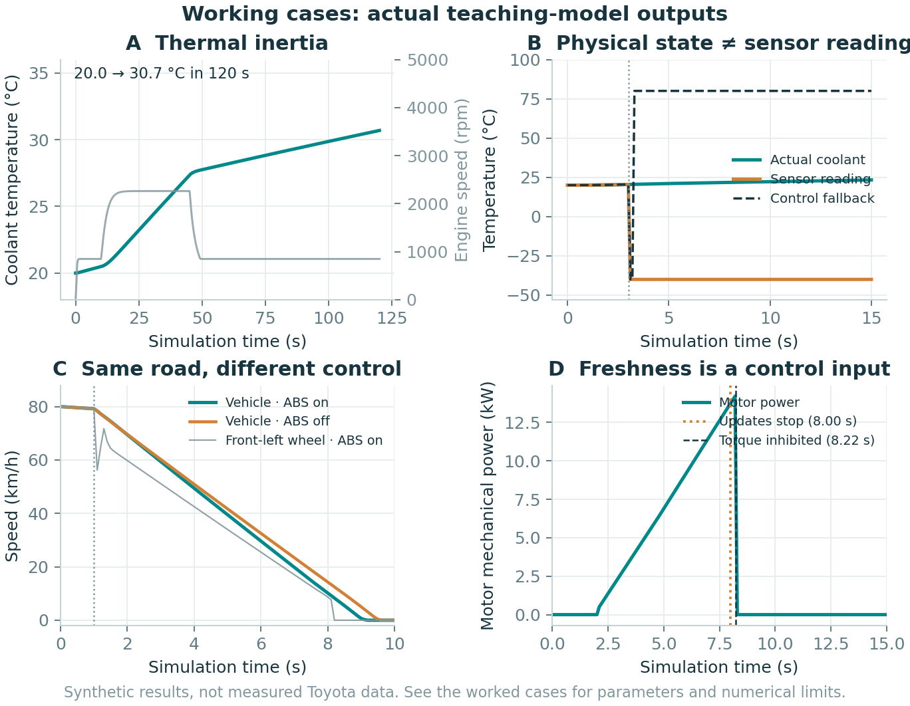

# Worked cases: observations you can reproduce

Version 0.3.0 · 9 November 2026

These results were computed by the supplied simulator, using its default generic
teaching parameters. They are **synthetic results**, not Toyota measurements or
calibration. The example files are generated by the same core used by the dashboard
and command-line runner. Each run has a CSV time series, a JSON file containing
parameters, states, events and final diagnostic requests, and a human-readable CAN
transcript under `examples/runs/`.

From the unpacked project directory, regenerate everything with:

```bash
python3 tools/generate_examples.py
```

Time-series samples are 100 ms apart; the plant step is 2 ms. A controller change
at an exact tick can first appear in the following saved sample. Event timestamps
are the better source for fault-detection times. A “stop below 0.5 km/h” and a
zero-speed sample are deliberately separate summary fields.

## 1. Start a single engine ECU and follow the heat



**Hypothesis:** combustion produces torque immediately after cranking, but coolant
has thermal inertia. The dyno stand stays stationary even when engine speed rises.

```bash
python3 run.py --scenario engine_warmup --output examples/my_warmup
```

The engine starts from 0 rpm, passes through CRANKING and RUNNING, and reaches a
sampled peak of **2263.3 rpm** as the script changes accelerator
position. At 120 s the actual coolant has risen from 20.0°C to
**30.68°C**, with **0.05339 L** of modeled fuel
used. Vehicle speed remains zero because this profile is a stand.

This is partial warm-up. Do not expect operating temperature after every two-minute
run. Compare ECU crank speed, mass airflow and coolant PIDs against the physical
state. Extend the duration or change the manual load to explore the heat balance;
the extra time continues with the script's final idle input.

## 2. Disconnect the coolant-temperature sensor

**Hypothesis:** a sensor reading can be wrong while the physical quantity remains
normal; clearing diagnostic memory does not repair that sensor.

```bash
python3 run.py --scenario ect_open --output examples/my_ect_fault
```

At 3.00 s, the ECT circuit becomes open. Its simulated pull-up input is **5.000 V**,
with a full-scale **4095** ADC count and zero branch current. The branch resistance
is `null`, marked invalid; no finite resistance is reported. The sensor temperature
display is **−40°C**, with invalid measurement status. After 200 ms the teaching ECU marks P0118 pending, uses an
80°C fallback estimate, and applies a 65% torque multiplier. At
**3.50 s**, P0118 becomes confirmed and the MIL turns on.
The final physical coolant is **23.32°C**, while the reported
sensor remains **-40°C**. These are distinct signals.

In the final transcript, `01 05` returns `41 05 00`; the temperature conversion is
0 − 40 = −40°C. `03` reports P0118, encoded as bytes `01 18`. Use the dashboard's
clear button, continue time, and observe the fault returning. These 200/500 ms rules
are an accelerated lesson, not regulatory emissions confirmation logic.

### Inspect the same cause in the new task workspace

The six task buttons provide a separate interactive setup: **Healthy baseline**
runs 1 s from a selected 25°C coolant initial condition, then **Open circuit**,
**+0.20 s**, **+0.30 s**, **Read DTC**, and **Repair & clear** expose each transition.
This task begins near 25°C; the scripted `ect_open` recording above retains its
20°C initial condition and its fault at 3.00 s.

Choose **ECT electrical circuit**, then probe the physical node voltage, ADC count,
reported temperature and control temperature. At exactly 25°C the synthetic
2,500 Ω NTC and 2,200 Ω pull-up give `5 × 2500 / 4700 = 2.659574 V`. The 12-bit
ADC gives count 2178 and reconstructs 2.659341 V. Opening the path separates true
coolant temperature from the invalid sensor report and later 80°C fallback.

Invalid, substituted and stale finite scope values use dashed segments. Null
resistance leaves a gap. Recorded samples are 100 ms apart, so inspect the event
timeline for the monitor's exact transition time. The [workspace guide](SCHEMATIC_WORKSPACE.md)
and [connector reference](CONNECTOR_REFERENCE.md) explain the five screens,
measurement boundaries and illustrative harness mapping. Clearing the code while
the input remains open still allows it to return after the teaching debounce.

## 3. Follow power through EV, hybrid and braking states

**Hypothesis:** the supervisor changes sources and braking allocation while the
same physical vehicle continues moving.

```bash
python3 run.py --scenario phev_city --output examples/my_phev_cycle
```

The DC link precharges before the contactor closes; torque is inhibited during
precharge. The first launch is electric, the first braking event recovers energy,
and the later high-demand launch also uses the engine. The vehicle reaches
**102.00 km/h**, stops twice, and ends at zero speed after 60 s.
SOC changes from 75.0% to **74.461%**; gross battery discharge
is **0.16177 kWh**, and gross charge is
**0.06572 kWh**. Gross charge and net SOC change are different
quantities because driving and auxiliaries consume energy during the same run.

This is an educational sequence with deliberately visible transitions, not an EPA,
WLTP, Toyota, or standardized urban drive cycle. The transmission is a generic
parallel-hybrid approximation, not a Prius planetary gearset.

## 4. Begin with low SOC

**Hypothesis:** the engine can support propulsion and a charging request when the
supervisor enters charge-sustain operation.

```bash
python3 run.py --scenario low_soc --output examples/my_low_soc
```

The pack begins at 22.0% SOC and ends at **22.420%** after 45 s.
The supervisor requests up to 5 kW of generator shaft power; the sampled maximum is
**5.00 kW**. Mode is CHARGE SUSTAIN during traction. Battery
current is negative while net charging, and engine fuel use is
**0.09741 L**. The narrow run increases SOC by only
**0.420 percentage points**; it is not a complete
battery recharge. Generator output is limited when the battery cannot accept charge.

## 5. Compare ABS on the same split-friction surface

**Hypothesis:** per-wheel pressure modulation reduces sustained locking in this
specified model. Keep every other input identical for the comparison.

```bash
python3 run.py --scenario abs_split_mu --output examples/my_abs
python3 run.py --scenario abs_split_mu --set abs_enabled=false --output examples/my_no_abs
```

Both runs start at 80 km/h, coast for 1 s, then apply 85% braking. Left-road friction
is 0.20 and right-road friction is 0.80. The shared first-second coast covers
**22.11 m**.

| Observation | ABS enabled | ABS disabled |
| --- | ---: | ---: |
| Total distance from time zero | 110.32 m | 115.51 m |
| Distance after brake command at 1 s | 88.21 m | 93.40 m |
| First saved speed below 0.5 km/h | 9.1 s | 9.5 s |
| ABS active time | 7.07 s | 0.00 s |

Inspect the four slip and pressure traces; with ABS disabled, wheels reach locking
slip. These distances apply to this toy tire curve, pressure controller and fixed
conditions. They do not establish real-vehicle stopping performance. The associated
yaw-brake assistance is reduced-order and omits lateral tire and body-sideslip states.

## 6. Ask a nearly full battery to accept regeneration

**Hypothesis:** restricted charge acceptance moves braking work to friction brakes.

```bash
python3 run.py --scenario regen_limit --output examples/my_full_pack_braking
python3 run.py --scenario regen_limit --config examples/normal_soc.json --output examples/my_normal_pack_braking
```

Both vehicles start at 60 km/h and apply the same 30% brake command after 1 s.
Only initial SOC changes: 97.5% versus 75.0%.

| Energy over the 35 s experiment | 97.5% starting SOC | 75.0% starting SOC |
| --- | ---: | ---: |
| Gross battery charge | 0.00856 kWh | 0.02662 kWh |
| Mechanical regeneration | 0.01157 kWh | 0.03209 kWh |
| Friction-brake dissipation | 0.04335 kWh | 0.02249 kWh |
| Total distance | 120.60 m | 120.60 m |

Charge power tapers between 90% and 98% SOC. Mechanical regeneration exceeds stored
battery energy because the motor/inverter conversion is lossy and auxiliaries still
consume power. The stopping distances remain similar because friction braking fills
the request when regeneration is limited.

## 7. Remove the BMU heartbeat

**Hypothesis:** a supervisor must distinguish stale data from a healthy unchanged
measurement.

```bash
python3 run.py --scenario bmu_timeout --output examples/my_missing_bmu
```

Messages stop at 8.00 s. The last message arrived at 7.90 s; the 20 ms supervisor
therefore detects message age greater than 300 ms at
**8.22 s**. It records the local
`BMU_STATUS_TIMEOUT` teaching label, inhibits torque, and opens the traction path.
The car continues coasting and ends at **19.76 km/h**.
A fault does not magically remove kinetic energy. No generic emissions MIL is
asserted for this local network fault.

## 8. Force a low cell-voltage input

**Hypothesis:** persistent out-of-range battery sensing causes a latched traction
shutdown rather than continued torque production.

```bash
python3 run.py --scenario cell_low --output examples/my_low_cell
```

At 8.00 s one measured cell channel is forced to 2.30 V. The BMU threshold is 2.80 V
for 200 ms, so shutdown occurs at **8.20 s**. Final
contactor status is FAULT, and battery current and traction output are zero.
The stored label is `BMU_CELL_UNDERVOLTAGE`; it is explicitly a teaching identifier,
not a claimed Toyota trouble code. Ordinary cells are aggregate pack/96 readings
with a nominal spread; this does not model 96 independent cell electrochemistry
states. Remove the injection and cycle ignition to reattempt readiness.

## Read the recordings critically

`examples/RESULTS.csv` and `RESULTS.json` provide the comparison values above.
Each `.trace.txt` contains requests made **at the end of its run**, not requests
polled continuously throughout the CSV. Thus a healthy engine-speed response can
be zero at the end of a PHEV stop while earlier records show combustion running.

The battery ledger checks chemical energy = terminal energy + resistive heat.
This is a check on the modeled battery equations, not proof of complete vehicle
energy closure: precharge resistor/capacitor energy, detailed 12 V loads, lateral
motion, full engine maps and several other losses are outside this first model.
